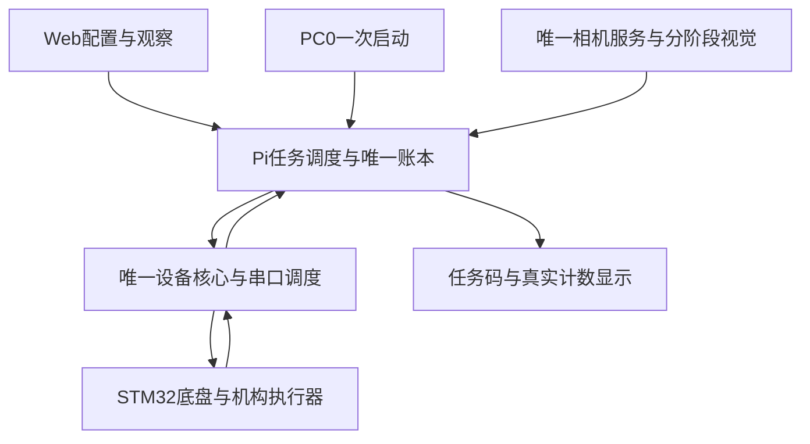

**初赛整机实施方案与持续迭代约定**

版本：方案v1，2026年10月30日。目标日期：11月6日湖南省赛。当前目标：先稳定完成初赛的扫码、两批取放、第二层码垛和返航，再提升速度与放置精度；决赛后置。

本方案确定实施结构、对位选择方法、交付顺序和验收条件。它是后续实施依据，不是已经完成的功能清单。本轮只编制方案，不恢复此前暂停的控制代码修改、部署、烧录或设备操作。历史实物结论仍为：.50横移+Y未通过，整机闭环未验收。

**一、确定采用的主方案**

沿用现有STM32执行闭环、Pi视觉和任务逻辑、三槽机构以及OpenCV识别，采用“已验证路线粗停 → 固定观察姿态 → 工作窗口判断与必要修正 → 版本化机械动作 → 真实结果确认”的闭环。正式任务由Pi独立调度，整个过程共用唯一串口核心。

不要求每次都把环追到图像正中心。先通过实物建立每个工位可可靠抓放的工作窗口；粗停已进入窗口，就直接执行已绑定的机械动作。超出窗口才调用已验收的局部对位方法。窗口不能凭眼睛、像素死区或理论尺寸随意放大，必须对应实际抓取、放置、码垛结果。

对位策略设为可替换模块，任务流程不绑定具体执行器。v1优先复用已有固定观察基准和底盘小位移链；它在实物通过前不具有正式任务权限。同时进行有限范围的“伸缩+转臂”可行性验证，作为替代候选。不能把升降+伸缩当成两条水平轴，也不要求先完成通用机械臂逆运动学才能推进任务。

已知条件：三舵机5V供电，PE9为270°/25kg档，PE11为359°/35kg档并转动全臂，PE13为270°/25kg档。升降最高点为0、向下140mm；伸缩最近端为0、向外107mm；没有硬件限位。上电准备由人工摆零、确认并建零，再执行已核对的初始收拢姿态。相机安装保持原状，随机构运动。

第一版不以最高环分数或亚毫米对位为前置目标。抓取、粗加工放取、第一层放置、第二层码垛分别定义可接受窗口；码垛能稳定支承的窗口可能明显小于地面有分放置窗口，不能共用一个宽松阈值。目标环等级在实测后选定，保证遵守任务顺序及放置规则，不预先承诺一环成功率。

**二、哪些复用，哪些必须补齐**

| 内容 | 决定 | 边界 |
| --- | --- | --- |
| STM32电机协议、CAN调度、里程计、轨迹、机构执行器 | 复用，针对具体缺陷修补 | 保留首发故障、停止确认、250ms新鲜度和500ms心跳保护 |
| .50局部交接与六节点保持查询 | 作为扩展基础 | 已有局部功能；完整导航运输交接仍需设计、联合测试和实车验收 |
| 跑图成果 | 复用已记录路线与参数 | 原有版本跑通不能自动给新联合固件实车许可；必须核对路线、负载、方向和完整外形 |
| 机械示教表 | 保留原版本，引用具体检查点 | 先核对本车零点、行程、终态和碰撞；不改写旧表，不假定前五行就是运输姿态 |
| OpenCV二维码、物料、环号识别 | 继续使用 | 仅修已复现错例，按任务阶段启用；不启动新模型训练迁移 |
| task/ledger的顺序、颜色映射、去重规则 | 复用 | 提取与设备无关的规则，新增真实证据适配；不能把simulation改名physical直接放行 |
| 浏览器调试页 | 保留人工调试能力 | 正式任务不依赖页面续租；显式急停仍可停止正式任务 |
| 雷达动态规划、PE14收放 | 保留后续模块位置 | 不作为验证其他链路的前置条件，但未验证时不能宣称随机障碍比赛已覆盖 |
| 决赛三角物料、转盘放置 | 后置 | 用户已确认结构兼容；实物与决赛流程验证另开阶段，不阻塞初赛 |

完整问题依据：[63项审计报告](provincial_system_audit_20261030.md)。本方案优先关闭初赛阻塞项，63项不要求无差别同时开工。

**三、运行结构与控制权**

图中是目标结构；PC0事件经STM32和设备核心上报，图示不表示Pi直接读取PC0。显示链也必须经过受控接口，不再创建第二个串口所有者。

正式模式只有以下几类：

| 模式 | 谁允许发动作 | 网页关闭的处理 | 退出条件 |
| --- | --- | --- | --- |
| OBSERVE | 不接受运动目标 | 无运动可中断 | 显式进入调试或准备任务 |
| MANUAL | 已持权的人工调试会话 | 保留现有释放/租约到期停车 | 人工结束或故障 |
| PREPARED | 已完成比赛前基准和姿态核对，等PC0 | 浏览器不承担任务保活；未按PC0不执行赛程 | PC0有效事件、准备失效或取消 |
| MISSION | Pi内部唯一任务owner | 页面隐藏/断网不释放任务owner；显式STOP仍有效 | 完成、明确终止、故障或任务监督失效 |
| FAULT | 只读与受控恢复，不继续目标 | 保留故障证据 | 核对后人工重新准备，不自动续跑旧动作 |

MISSION不能通过伪造浏览器renew维持。设备核心继续负责MCU心跳和反馈期限；任务调度、视觉、账本写入不能占用串口线程的长锁。任务线程本身停滞也必须被监督，不能出现“任务已死、串口心跳还在所以无限保持执行”的状态。任务owner切换绑定当前boot/session、零点版本和运行ID。

人工准备与比赛启动分开：人工置最高/最近 → 建零 → 核对三舵机参考 → 执行初始收拢检查点 → 核对尺寸和载荷 → 进入PREPARED → PC0启动正式任务。上电不自动找机械端点；无硬限位时不能盲走到头建零。

正式任务内部不要求每到一个工位再按PC0。其授权来自本次已经启动且持续有效的MISSION；调试模式仍保留原有PC0与用户现场动作边界。为实现这一点需要明确的正式接口，不是删除Arrival中的按键判断。

**四、唯一的动作和结果约定**

所有模块使用同一个语义合同。字段名为方案约定，落地时由A统一评审协议，不在各模块各自发明相似字段。

| 信息 | 必需内容 |
| --- | --- |
| 身份 | run_id、action_id、boot_id、session_id、控制权代次 |
| 参数 | 工位、操作类型、目标坐标系和单位、机械表修订、路线版本、标定版本、参数摘要 |
| 机械条件 | 零点版本、五个执行器目标、空爪/持料状态、三槽载荷、允许的运动包络 |
| 时效 | 接纳期限、执行期限、阶段截止时间；分别记录，不用同一个timeout含糊代替 |
| 执行结果 | ACCEPTED、RUNNING、MOTION_DONE、FAILED、CANCELLED、UNKNOWN |
| 任务成功 | CONFIRMED：执行条件与对应新视觉证据都成立后才生成 |
| 证据 | 停车/姿态代次、动作前后帧ID、采集身份、时间、观测配置、颜色/环号/物料位置及判定原因 |

MOTION_DONE只说明执行器动作完成；CONFIRMED才允许改变物料账本及成功计数。姿态改变后必须建立新的观察代次，旧帧不能跨动作复用。同一动作重复结果只提交一次。

命令已被接受但回复丢失时，查询同一动作状态；不创建新ID重发。查询仍不能确定则UNKNOWN并停止相关任务。核心重启后恢复的是记录和诊断能力，不是自动重放物理动作。

账本继续沿用现有SQLite事务基础。任务调度可以等待必要持久化成功，但必须在串口线程之外完成；保存失败不提交成功、不改变可执行参数版本。Web和屏幕读取同一个已确认计数源。

**五、底盘和机械之间怎样交接**

初赛第一版采用“走时机构保持，停稳后机构动作”，不引入行驶中抓放。车载料槽有料不等于夹爪持料；正常跨区前应确认物料存车、夹爪空及运输姿态有效。

每段统一顺序：

1. 机构进入已验证的运输检查点，确认两轴实际位置和稳定反馈、三路PWM命令及当前载荷；五个目标必须完整。
2. 同一设备核心提交带身份和版本的运输交接，MCU确认保持条件；保留零点、PWM、编码器和会话。
3. 底盘执行已许可路线，持续查询四轮、两轴及所需IMU数据；保持轴或通信失效时停止。
4. 路段完成后发零速并取得新的停车稳定证据，进入正常停靠态。
5. 正常交回机构，执行观察姿态；不能用全局STOP、重启核心或每段重新CONFIG来代替正常到站。

需要在实现前专门核对路线档与微调档的切换：保持连续里程计和坐标含义，不能因使用config10把前面路线原点重置。若现执行器不支持连续状态下切换策略，就新增显式且受限的切换接口；不能靠重新初始化掩盖问题。

已有空爪微调合同只覆盖有限小位移。扩展正式运输时要明确空载、单槽、三槽载荷和包络，不把当前空载reach84检查点直接当作所有运输姿态。

**六、对位路线的确定方式及停止试错条件**

先保留当前固定观察位，把“到位”定义成可重复执行后续抓放的工作窗口，而不是一个脱离任务的4像素门槛。每个窗口绑定工位、平面、相机、完整观察姿态、机械动作表、目标环/料位及载荷条件。

| 层级 | 执行策略 | 允许进入的条件 |
| --- | --- | --- |
| L0 | 无修正，直接执行绑定机械动作 | 新观测与已验收参考一致，落在实物验证的工作窗口，后续路径和载荷匹配 |
| L1，v1优先候选 | 底盘小幅单轴修正后重新观察 | X/Y实物方向、位移、重复性、停车和航向已验收；不能使用目前失败的+Y直接自动运行 |
| L2，替代候选 | 伸缩+整臂旋转的局部修正 | 几何可达、舵机重复性、正反响应、同姿态视觉及碰撞范围通过验证 |
| 超出范围 | 不抓放；拒绝进入该动作 | 不自动在未标定区外推，也不同时让两个控制器追同一个目标 |

L0并非“去掉视觉随便放”。应先在已知成功机械基准附近用多个实际偏差验证：哪些偏差仍能抓起/放稳、哪些不能。码垛窗口单独建立。只能使用有证据的子范围，不把少量成功点包成无限大矩形。

第一轮现场验证安排为一个有限调试时段，建议2～4小时，设备可用且获准操作后才计时。先收集同一工位至少5次独立粗停的实际偏差和后续单件结果，判断L0是否有可用范围；然后检查现底盘X/Y小位移。该次数是工程起点，不是可靠率证明。

若仍出现明显抖动、轮迟动、偏航或实际位移无法复现，本时段不再持续增加底盘增益或改符号：冻结失败结果，把该方法维持为不可用；下一次现场资源转给L2小样验证。底盘实际不稳定时，不以放宽残差判据“验收”。

L2先做一个固定观察姿态和2号环，不做全工位通用控制：核对臂转轴O、实际夹持中心G和相机C；在可达且有余量的位置量测伸缩/转臂小幅正反响应。升降负责观察与释放高度，不被当作水平第二轴。模型输出的目标仍由正式机构接口检查0～140/0～107mm、角度、碰撞和期限。

L2每次改变机构姿态后，必须更新对应的姿态证据和合法观察关系，不能删除绑定后继续使用L1矩阵。先用有限姿态的经验标定表，只有验证收益明确才发展完整几何模型。

正式运行的每个工位在本次任务开始前冻结一种已验收策略。v1不在比赛途中因L1失败就自动切换尚未共同验收的L2；替换只发生在下一次准备阶段，使用新的版本。若L0/L1/L2均不能证明可靠抓放，则真实单件关口未通过，不能用模拟结果替代；任务、视觉回放和接口开发仍可独立推进。

**七、初赛机械动作和视觉证据**

先建立小而完整的工位表，保留用户已有示教，补齐缺失的上下文：

| 动作族 | 需绑定的内容 | 成功证据 |
| --- | --- | --- |
| 原料取料并存车 | 颜色、转盘稳定观察、抓取姿态、槽位、入槽路径、退出姿态 | 来源正确、抬起后持料、目标槽有料、爪已分离 |
| 从车载槽取出 | 槽号及其实际料盘角、接近/夹紧/抬离路径 | 原槽身份正确、持料明确、槽位变化一致 |
| 粗加工放置 | 对应环号、到站参考、释放前对位、落料及撤离 | 释放分离、指定位置物料稳定；首次接地后不推料纠偏 |
| 粗加工再取 | 环号、颜色和该物料账本位置 | 抓起及存车确认，避免把空抓算成功 |
| 暂存第一层 | 对应环号、释放高度、已验证窗口 | 正确下层位置及稳定结果 |
| 暂存第二层 | 同色下层位置、顶面高度、码垛窗口和撤离 | 同色正确支承、释放后稳定，不以地面圈像素替代顶层落点 |
| 运输与观察过渡 | 五目标、负载、线缆/车体包络 | 两轴反馈、PWM保持和经过实物验证的姿态条件 |

同组并行动作先限于已经验证互不碰撞的组合；v1默认分步执行。不能把Group的同时派发当同步轨迹。三槽应使用实际校准值，第三槽已有265°记录不自动改回理论270°。

视觉不必在每个机械微步骤都运行全部算法。按阶段选择二维码、物料、圆环或结果确认，复用唯一相机最新帧；预览限流，避免抢占执行反馈。先用现有样本设计可见的确认姿态，再集中采一次缺失样本。遮挡导致看不见时输出UNKNOWN，不通过把“没检测到”改成“空爪”解决。

任务计划沿用初赛两批顺序与颜色映射；当前模拟12抓12放作为语义回归参考。真实计数与屏幕接口必须逐步对齐，每次有效物料转移只计一次，内部重复握手、视觉帧和舵机微步不加次数。

**八、实施阶段及每阶段交付**

日期是当前目标排期，阶段能否结束取决于验收。设备暂停期间只推进离线内容；不能因为到了下一天就把未通过阶段标成完成。

| 阶段 | 目标时间 | 实施内容 | 可检查的交付与退出条件 |
| --- | --- | --- | --- |
| P0 基础修复与参数边界 | 10月30～31日 | 修C01/C02/C03/C13；两轴行程、统一单位与保存校验；明确模式和合同 | 每个缺陷有旧逻辑反例与修复回归；140/107边界、负值、非有限数、过期身份及保存失败均拒绝；现有可用路径不退化 |
| P1 正式执行骨架 | 10月31日～11月1日 | Pi任务owner、同一串口、底盘/机构正常交接、连续里程计、真实结果适配骨架 | 离线完成运输→到站→机构→运输的闭环及失联/丢回复负例；页面关闭不停止MISSION，显式STOP有效；MANUAL仍有租约保护 |
| P2 单件实车闭环 | 争取11月1～2日 | 有限时段选择对位策略；原料取存、短运输、取出、2号环放置与确认 | 整个单件过程由一次任务启动推进；无人工接力、无重复目标、无虚假计数；记录时间线、真实结果和故障首因 |
| P3 初赛完整流程 | 争取11月2～3日 | 三槽、三环、两批、第二层、返航、任务码/计数屏幕、对应路线 | 正确顺序、颜色和最终物料状态；零点、odom、身份贯穿；按实际场地覆盖起区和障碍条件 |
| P4 整场验收与冻结 | 11月4日 | 同版本整场重复、并发时效、冷启动准备、浏览器退出、载料运输 | 连续至少三轮实际完整完成且满足比赛时间；错误/未知不伪报；生成可复现发布包。三轮是最低工程验收，不是长期可靠率保证 |
| P5 复核和缓冲 | 11月5日 | 只修阻断问题；检查备份、启动清单、场地差异和备件 | 每个改动有对应复验；冻结比赛版和已知局限，保留上一可用版 |
| 比赛日 | 11月6日 | 按冻结清单准备 | 不加入未验证功能；现场必要参数调整按限定范围和版本记录进行 |

P0/P1离线开发、视觉样本整理、机械表梳理和对位几何核对可以交错进行；真实P2必须等执行接口及所选动作的必要条件通过。P3不能用手动代按按钮的视频代替自主闭环。P4如果没过，就报告真实可完成范围，不宣称“准备就绪”。

若11月2日仍未形成单件闭环，立即停止提速、亚像素优化和大规模界面调整，集中解决最短单件链。若11月4日仍不能跑完整场，只能将已证实可执行的合法任务前缀作为应急能力如实列出，并核对该轮提前结束及计分规则；不能把部分完成重命名为整场完成，也不能盲目跳过后续任务。完整初赛仍是主目标。

**九、基础修复的具体范围**

| 项目 | 修复原则 | 必须保留的边界 |
| --- | --- | --- |
| C01迟到回复 | 所有feed入口统一判断请求期限和可证明的接收时间；覆盖读阻塞/调度延迟 | 不破坏原有期限内已到回复先处理的规则，不把旧包接收时刻刷新成有效采样时刻 |
| C02准备无限等待 | 每个准备阶段有明确截止时间和原因；位姿无效超时退出合同 | 超时退出不谎称已停车，不自动重新准备PC0 |
| C03异常残留状态 | 异常路径统一取消sequence/arrival/centering、撤销owner并标记核心失效 | 尝试STOP与停车已确认分别显示；保持首发证据 |
| C13保存失败残留 | 先完成原子持久化，再提交内存版本与请求成功缓存 | 同一失败请求不制造可执行新版本，保留旧文件及删除归档 |
| 正向行程 | 固件最终边界与主机输入均检查升降0～140mm、伸缩0～107mm | 端部工作余量另列；范围内仍可能碰撞，不能用两条范围代替姿态互锁 |
| 单项BUSY等待 | 普通单项也绑定阶段截止；只对明确未接纳请求有限等待 | 已接受动作或结果未知不重放 |
| 同步IO与调度 | 参数写入、日志和任务账本不占用串口循环长锁；反馈/停止优先 | 不通过放宽250ms/500ms来掩盖调度饥饿 |

旧自动Pose的49/50mm范围与真实140/107mm不同。处理方式是根据已经核对的机械动作和安全包络建立正式范围配置，不是直接全局替换两个常量、照搬人工调试模式。各入口和组动作最终必须接受同一套正式检查。

**十、可修改与可回退的配置结构**

将内容分为五类版本记录，先复用现有保存格式，只添加缺失字段和索引，不在赛前迁移全部历史文件：

| 类别 | 记录内容 | 改动后最小复验 |
| --- | --- | --- |
| 硬件配置 | 轴方向/换算/行程、PWM通道与角范围、几何与坐标约定 | 对应执行器、范围与互锁；影响共同方向时扩大到相关路线 |
| 工位配置 | 粗停点、朝向、观察姿态、目标平面、工作窗口、对位策略及标定 | 该工位到站、视觉与抓放；码垛高度变化需重验第二层 |
| 机械动作版本 | 五目标、顺序/并行组、速度/加速度、载荷、起止条件、停止后处理 | 被修改动作及相邻交接；不得自动重写所有保存表 |
| 视觉配置 | 设备、分辨率、ROI、颜色/形状、编号模型、稳定窗 | 对应样本与实车观察；改变成像映射时重验受影响对位标定 |
| 比赛任务配置 | 初赛流程、颜色映射、路线引用、工位动作引用、阶段和整场期限 | 语义全回放；改变执行顺序则补受影响实车链及整场复验 |

每次准备任务生成不可变的配置清单，固定源码/固件版本、机械表ID与修订、相机配置和标定摘要、路线与场地版本。任务运行中不能热改这些内容；用户保存新版本只供下一次准备选择。

参数记录状态依次为DRAFT、OFFLINE_PASS、FIELD_PASS、MATCH_FROZEN；旧版本可标RETIRED。离线通过不自动升级FIELD_PASS。版本引用的参数变更后，派生标定/工作窗口必须重新核验，不沿用旧审核标记。

回退需要两部分：恢复成套软件与配置引用，以及重新核对现场零点、姿态、载荷和会话。不能回滚旧runtime、旧零点、旧boot/session来“恢复动作”。保留已删除版本归档，不因恢复软件把删除项重新变为可选。

普通参数试验采用“一个变量族、一个候选、一个结果记录”。例如本轮只改轴加速度，就保持观察位、颜色阈值、路径和电机极性不变；若必须联合修改，则作为新联合候选完整记录。失败候选留证据但不成为默认版本。

**十一、失败和等待策略**

| 情况 | 第一版处理 | 不采用的处理 |
| --- | --- | --- |
| 停稳后短时识别不到 | 在该阶段累计期限内等待新帧或执行已验证的观察过渡 | 反复重置计时、拿旧框继续运动 |
| 原料盘运动 | 等待满足已验证取料条件的窗口；把等待计入整场及规则停滞预算 | 看到一帧静止就假定剩余时间足够 |
| 对位误差在已验收窗口 | 直接执行绑定动作，省去无必要微调 | 为追求图像整数中心继续移动 |
| 超出对位能力或不收敛 | 停车并记录，终止该动作/任务；下次准备再更换已验收策略 | 现场自动切到未共同验收的另一控制器 |
| 夹爪状态不清 | 保持合适的已验证姿态，有限重观测；仍未知则终止 | 默认空爪、盲目张爪或重复夹取 |
| 确认空抓且来源物料仍在 | 可另行验证一次有界重试策略；v1未验收前默认终止 | 无限尝试或增加成功计数 |
| 已释放/首次接地后偏移 | 记录真实结果并按规则处理，不能推料纠偏 | 自动再抓放同一目标作为“修正” |
| 运动结果未知或通信失效 | 撤销任务许可、请求停止并保留停车是否确认 | 换新ID重发，或无证据自动续跑 |
| 记录/配置保存失败 | 拒绝新任务或新版本生效，串口监督继续 | 悄悄用未落盘参数继续比赛 |
| 任务或控制核心重启 | 保留诊断，人工重新准备 | 沿用重启前机械零点和运动队列 |

所有等待由父阶段累计计时，重观测和重试不能重新获得完整预算。现实验对中12步/40mm/60秒不是正式比赛的可用时间承诺；正式工位期限由实测耗时、剩余赛时和规则停滞条件共同限制。

**十二、路线和障碍的可交付范围**

先以已经核对的场地和路线完成搬运闭环。冻结路线是一种测试范围，不是随机障碍比赛的完整解决方案。正式比赛如存在随机障碍，必须在P3/P4之前完成相应通行证据与路线选择能力；不能默认所有道路OPEN。

优先复用现有路线段和图结构，选择预先验证的可通行走廊；只有获得规则允许且本车能够提供的障碍信息，才选择对应备选路径。检测不足、未配准或道路UNKNOWN时，不将路线标为正式可执行。动态规划、雷达收放和新地图配准若不能按期通过，报告实际未覆盖条件，而不是承诺任意场地都能跑。

车体、料槽、载物、相机线束和雷达收拢包络一起检查；初始尺寸合格不等于运行转弯扫掠合格。主体名义尺寸、CAD和实车实际外形分别记录。PC1两启停区及朝向用各自参数，不未经验证直接镜像。

**十三、时间与性能如何持续改进**

先记录真实时间，不用模型耗时替代：启动/扫码、各段导航、每次机构动作、对位、结果确认、转盘等待和返航分别统计，避免同一次等待重复计时。以完整初赛≤180秒为边界，建议把常态运行目标设为≤160秒，留约20秒余量；这是工程目标，当前没有实测支持，不能当作达成承诺。

每轮记录总时间和最慢的三个阶段，以及它们的成功、失败、未知数量。优先减少不必要的对位、重复观察姿态和多余转槽，再优化确有空间的动作速度或安全并行。不要先把所有动作速度都调高。

并发验收在Pi真实运行相机、任务、设备反馈、屏幕和正常预览的情况下进行。记录串口请求往返、各状态源龄、视觉帧龄和吞吐、控制循环最大间隔、CPU/温度/内存；测试表明超时保护正确触发与时效全程合格分别报告。界面FPS、相机FPS和有效识别频率不混用。

回归按改动风险选择：单位/范围/合同与故障路径必须有有意义的边界和反例；纯文字或布局改动不新增机械测试。正式发布前做一次受影响模块联合回归；通过后没有新变化不反复跑相同测试消耗现场时间。

**十四、双电脑分工与每日进度格式**

沿用现有A/B协作边界，不创建额外设备所有者，不发送外部消息。

| 负责人 | 工作范围 | 交付接口 |
| --- | --- | --- |
| A，当前电脑 | 固件、设备核心、交接、MISSION权限、路线执行、对位执行、统一Web入口、部署和实车取证 | 动作合同、真实执行事件、故障原因与工位参数 |
| B，现有独立分支 | 视觉样本、纯识别与结果确认、任务规则和账本的真实证据适配 | 新鲜观测、物料确认事件、模拟/真实域隔离测试；不打开串口 |
| 用户 | 人工零点、场地与物料摆放、实际动作触发和实物验收 | 实际方向/位移/抓放结果；助手整理记录，不要求反复手抄所有参数 |

共享合同先由A定版本，B针对冻结接口开发。双方独立分支/PR，A审查后合并；原始样本有清单和SHA，不能用整目录覆盖。相机配置、公共入口、centering/arrival及固件不同时改。本文的日期和初赛优先级作为新的计划依据，旧三天安排及B任务单中的日期是历史目标，不代表已经完成。

每完成一个可验收步骤更新一条记录：目标、代码/参数版本、证据路径、离线结果、实物结果、仍未通过项、下一项最小动作。状态只用未开始/离线通过/待实测/实测通过/失败待定位；不把“写完代码”写成“实现整机”。

每次现场时段开始先核对固件、boot/session、零点、故障、载荷、人工移动/断电历史；每次异常先保留首发时间线。动作结束后读取同一次动作结果，再决定下一步，不用另一次启动的正常窗口覆盖失败。

**十五、方案可修改的边界和当前第一项交付**

固定不变的是：初赛优先、唯一串口、真实成功证据、任务计数去重、正常到站交接、明确单位与版本、实际行程和碰撞约束、故障可定位、失败不盲重放。

允许迭代的是：工位粗停点、观察姿态、已验证工作窗口、底盘或机构局部对位策略、机械动作速度/加速度、有效的视觉参数和路线段选择。任何改变按第十节决定复验范围，不能用“可修改”跳过验收。

下一实施批次应是P0：四处已复现缺陷、两轴范围和保存事务，外加P1的动作/控制权合同及离线往返夹具。与此同时，整理现有原料抓存、运输和粗加工观察检查点，补齐五目标和载荷字段。此批次的完成物是可审查的源码差异、针对性回归结果和待实测清单；它不会自行赋予新固件实车许可。

当前可确定的是实施路径和验证方法；尚不能保证11月6日前所有关口必然通过。若某个物理能力验证失败，按明确的局部替代路径推进，同时保留其余已通过模块，避免反复推倒整套工程。

依据：[整机审计及最新用户补充](provincial_system_audit_20261030.md)、[双机协作边界](https://github.com/risiairline-dotcom/cybertruck/blob/6f8694f/docs/dual_pc_handoff_20261029.md)、[B视觉工作范围](vision_B_plan_20261030.md)、[当前局部Arrival合同](https://github.com/risiairline-dotcom/cybertruck/blob/6f8694f/pi/robot/device/arrival.py)、[当前模拟证据检查](https://github.com/risiairline-dotcom/cybertruck/blob/6f8694f/pi/robot/task_check.py)。
